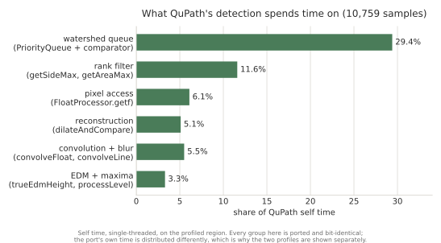
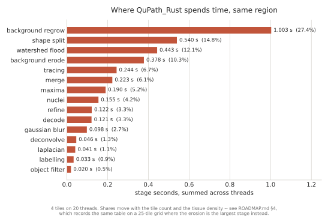
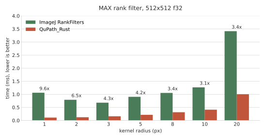
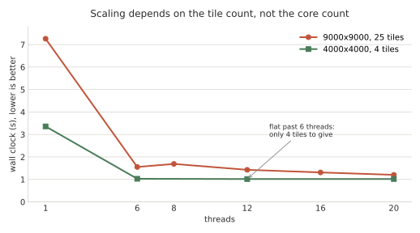
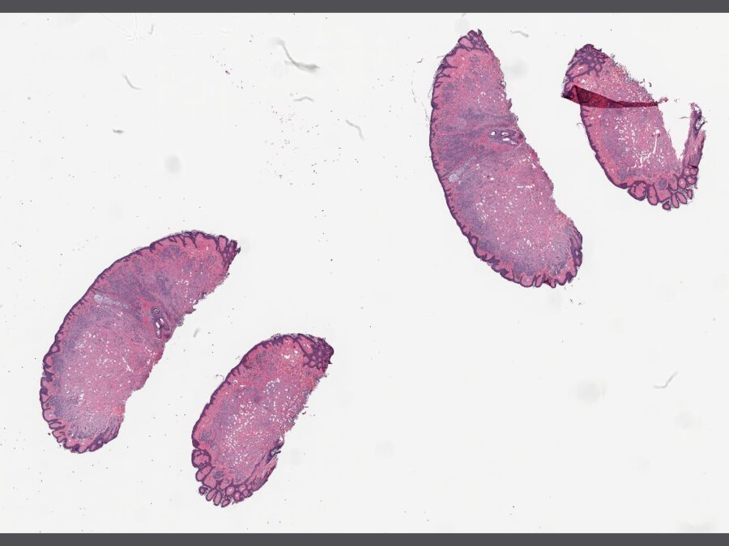
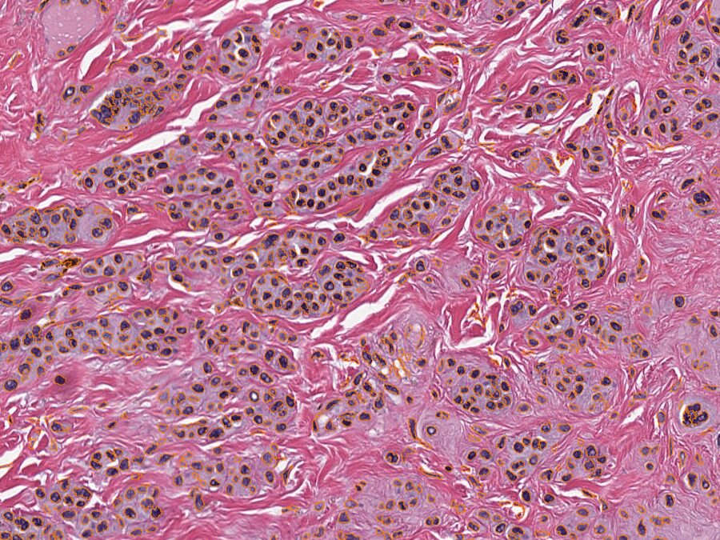
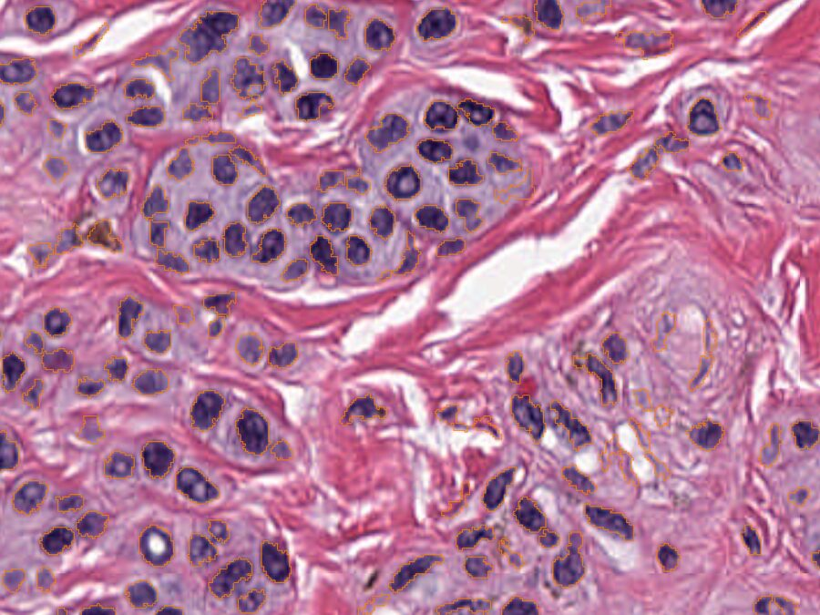

# QuPath_Rust

[](https://github.com/Dante-Berth/QuPath_Rust/actions/workflows/ci.yml)

An accelerated Rust implementation of parts of [QuPath](https://qupath.github.io/),
reproducing its logic with a data layout suited to bulk analysis.

**Parity is measured rather than assumed, and it is currently incomplete.** Over
ten regions of CMU-1 this finds **1.065x** QuPath's object count — 156,979
against 147,351, a range of 1.012–1.129 by region, and always in the same
direction: this over-counts. The nuclei that do correspond agree well (97.9% of
QuPath's 17,079 nuclei match one-to-one, mean Dice 0.921), so the gap is a
population of extra objects on sparse tissue rather than boundaries falling in
different places. Seven pipeline stages have been ruled out against QuPath on
real tissue, pixel for pixel; three remain. Tracked as D-009 in
[DIVERGENCES.md](DIVERGENCES.md), with the numbers in
[docs/dev/MEMO.md](docs/dev/MEMO.md) §2.

Read that before the speed figures, not after: a 6.5% density-dependent
over-count is not a rounding difference, and what is fast here is not yet
what QuPath computes.

The badge covers formatting, clippy, and the suite as it runs on a machine with
one 1.9 MB slide. It does not cover the tests needing the 177 MB benchmark
slide — each run's job summary names those explicitly rather than letting the
total imply they passed. See [Building](#building).

## Documentation

[docs/guide/](docs/guide/) is the user guide: opening a slide, detecting cells,
what the parameters mean, and getting the result into QuPath. Start there if you
want to *use* this. [docs/guide/parity.md](docs/guide/parity.md) is the page to
read before relying on any output.

[presentation/](presentation/) is a 20-slide deck on the port, the parity gap
and the verification method, regenerable from the scripts beside it.

The rest of `docs/` answers why the code is the way it is —
[MEMO.md](docs/dev/MEMO.md) for orientation, [ROADMAP.md](docs/dev/ROADMAP.md) for the
plan, [DIVERGENCES.md](DIVERGENCES.md) for every deliberate difference.

## Licence

GPLv3, matching QuPath. This code is written by reading QuPath's source in order
to reproduce its behaviour, which makes it a derivative work.

## Contributing

[CONTRIBUTING.md](CONTRIBUTING.md) has the gate CI runs and the rule that
matters here: a new parity claim needs a recorded fixture **and** a mutation
check showing the fixture can fail. Checking against a reading of QuPath's
source is not a test — three bugs that passed visual inspection are the reason
that is written down.

## Design principles

- **Objects are columnar.** Detections and their measurements are a struct of
  arrays — one contiguous column per feature, one row per object — rather than
  QuPath's per-object string-keyed measurement map. This is the main source of
  the speedup, not the choice of language.
- **Parity is the test suite.** Behaviour is checked against output recorded
  from QuPath itself, at documented tolerances. Intentional differences are
  recorded in [DIVERGENCES.md](DIVERGENCES.md).
- **Performance claims carry evidence.** Every claim is backed by committed
  benchmark output stating machine, thread count, and fixture.

## Status

Five crates on the parity path, each checked against fixtures recorded from a
real QuPath build:

| Crate | Does | Parity |
| --- | --- | --- |
| `qupath-objects` | Columnar detection/measurement table | recorded |
| `qupath-watershed` | Marker-controlled flood, bucket queue, 4/8-connected labelling, filled-region tracing | recorded, 3 + 13 + 17 cases |
| `qupath-filters` | MIN/MAX rank filter, ImageJ Gaussian blur, convolution, morphological reconstruction | recorded, 42 + 22 + 22 + 24 cases |
| `qupath-slide` | Aperio SVS / tiled TIFF reader, pure Rust | recorded, 5 regions + the level table and a tissue block against OpenSlide |
| `qupath-pipeline` | Tiles a region QuPath's way and runs every detection stage over it | colour deconvolution; object filters, 17 images; merge and split; boundary refinement |

And one that is not on it: `qupath-viewer`, a slide viewer with pan, zoom and
pyramid-level selection, tracked in [docs/dev/VIEWER.md](docs/dev/VIEWER.md). **It
claims no parity and no speedup** — QuPath's viewer is not what is being
ported, and nothing in it makes the detection pipeline faster. It is built
because the read side had nothing looking at it. See
[Viewing a slide](#viewing-a-slide).

**The detection chain is closed.** Every stage `WatershedCellDetection` runs
from the colour deconvolution to the objects it goes on to measure is ported and
pinned against output recorded from QuPath itself, and running on QuPath's own
tile grid: background subtraction by reconstruction, the Laplacian of Gaussian,
the regional maxima, the labelling, the flood, the region tracing, the
mean-intensity filter, the merge, the shape split, `refineBoundary` and the area
filter. What is missing is the tail — the measurements — which does not change
how many objects there are. The ROI **vertices**, the **boundary smoothing** over
them and the **cell expansion** were the rest of that tail. All three are ported
and pinned in `qupath-watershed`: the contour against ImageJ's own Wand over nine
cases, `smoothBoundaries`' four stages against QuPath over twelve more, and the
expansion's EDM/negate/flood chain over ten at four checkpoints each, every
intermediate pinned. **Of those three only the contour is called by the
pipeline.** `smooth_boundary`, `expand_labels` and `cell_areas` have no caller
outside their own parity tests, which is why the viewer exposes no control for
smoothing and why the counts above compare raw pixel boundaries against QuPath's
smoothed cells.

**The nuclei themselves agree, not just how many there are.** Over three
single-tile regions of CMU-1, against the mask QuPath recorded for every
nucleus it detected, the pooled Dice is **0.935, 0.934 and 0.880**, and
**97.9% of QuPath's 17,079 nuclei** find a one-to-one partner at Dice ≥ 0.5,
mean Dice 0.921 over matched pairs. Pooled Dice involves no matching decision,
so read it first. The regions fit one tile each, so none of the seam
resolution `DIVERGENCES.md` D-008 describes can reach these numbers: this is
detection compared against detection, pixel for pixel. Both sides are the
pixels each pipeline labelled — comparing QuPath's mask against a
rasterisation of our polygon would have measured our rasteriser. Reproduce
with `./parity/record-object-masks.sh` then
`cargo run --release --example object_masks -p qupath-pipeline`.

**Measured over ten regions of CMU-1 the pooled count is 156,979 objects against
QuPath's 147,351 cells — 1.065x, with a range of 1.012–1.129 across regions** and
always in the same direction: this over-counts. On the profiled 4000x4000 region
alone it is 26,647 against 25,757, 1.035x, from 1.86x — read that as one region
and the best of the ten, not as the result. Reproduce with
`./parity/record-cell-counts.sh` then
`cargo run --release --example cell_counts -p qupath-pipeline`.

What the gap tracks is cell **density**, inversely: sparse regions diverge by
6–13% where dense ones agree to within 1–3.5%, and the seam count does not sort
the table. So it is **not** primarily the tile-seam resolution D-008 predicted —
three of the ten regions are a single tile with no seams at all, and they still
disagree. Seven stages have since been ruled out against QuPath on real tissue,
pixel for pixel — the merge, the shape split, the colour deconvolution, the JPEG
decode beneath it, the labelling, the flood, and the background estimate, that
last at the 2048x2048 the pipeline actually runs it at. What remains between the
deconvolution and the first stage where the gap is visible is the blur, the
Laplacian and the regional maxima. See D-009 in
[DIVERGENCES.md](DIVERGENCES.md) and §2 of [docs/dev/MEMO.md](docs/dev/MEMO.md).

A matching count is also the weakest evidence of a match there is — two runs can
agree on how many objects they found and disagree about where every one of them
is. **That test has now been run**: `ObjectMasks.json` records QuPath's mask for
every nucleus over three regions, and the Dice and IoU above are over those
masks against ours. It is what turns "the counts agree within 6.5%" into a
statement about the objects. What it does not do is explain the count gap: the
region whose count disagrees most is also the one whose Dice is lowest, which
points at the same density-dependent divergence D-009 is open on rather than
away from it.

**None of the last four stages was the fix the roadmap expected**, and the
corrections are worth more than the code:

- The roadmap said for two revisions that `findRegionalMaxima`'s prominence test
  was what would bring the count down. It is ported now, bit-identically, and it
  removes two markers — its threshold gates a maximum's *value*, not its
  prominence, and the prominence test itself only ever discards maxima on an
  exact plateau, which a Laplacian of Gaussian of real pixels does not have.
- The roadmap then said the object filters "need only per-label sums and counts
  — no tracing", and that the area filter could be estimated on raw basins. Both
  are wrong at the call site: ImageJ's Wand traces a *threshold range*, so two
  basins meeting with no watershed line between them are one object, and the
  area filter runs after a merge-and-split on objects that do not exist yet.
- Its list of remaining stages then turned out to be missing one. Between the
  shape split and the area filter stands `refineBoundary` — a second Gaussian
  and a second Laplacian at sigma 1, on the raw deconvolved channel, guarded by
  a hard-coded `true`. A list of stages is not a reading of the source.

Three bugs the fixtures caught, all of which had been producing entirely
plausible images:

- The pipeline ran a **morphological opening in place of a top hat**. QuPath
  estimates its background by opening by reconstruction and then *subtracts* it;
  replacing the image with its opening keeps the background and discards the
  nuclei, which is the opposite. Wrong operation, wrong radius (2 px against
  16), wrong direction.
- Earlier, the port had been using the **DAB** stain vector under the name
  `EOSIN` — H-DAB deconvolution presented as H&E, a 52% error on the leading
  coefficient.
- Aperio's JPEG tiles carry no Adobe APP14 marker, so a decoder following the
  JFIF convention converts RGB as though it were YCbCr. The slide still looks
  like plausible H&E.

That is the argument for the whole approach in miniature: no test that did not
compare against QuPath's own numbers could have found any of them.

## Speed

On the region QuPath itself was profiled on — 4000x4000 at (27776, 5952) of
`CMU-1.svs`, same slide, same default parameters:


**4.7x single-threaded, 15.6x on twenty threads.** Read the single-threaded bar
when the question is whether the port is faster, because QuPath's 15.87 s was
measured single-threaded and QuPath parallelises across tiles in real use. And
read both as an *upper bound*: QuPath's time includes the tail this pipeline has
not written — the measurements — so some of that gap is work not yet done rather
than work done faster. The gap is decisive
either way; its exact size is not yet measurable.

The two profiles do not have the same shape, which is the point — a stage that
dominates QuPath is not the stage that dominates here:





QuPath's single largest cost is a `PriorityQueue<PixelWithValue>` of boxed
objects compared through an interface call — 29.4% of self time in one data
structure. Here the flood is 12.1% and the queue itself is a flat bucket array.
The port's own largest stage is the background reconstruction, which barely
registers in QuPath's profile at 5.1%. **Neither profile predicts the other**,
and this is why every optimisation in this repository is chosen from a
measurement of the port rather than from QuPath's flame graph.

Component-level, against ImageJ's own `RankFilters` on the same machine:



3.1–9.7x depending on radius, and the *shape* matters more than the peak: the
win is largest at small radii and settles around 3.4x at the radii detection
actually uses. Naively scanning the kernel per pixel was **7.6–35.6x slower**
than ImageJ before the rectangle decomposition replaced it — the algorithm was
the variable, not the language.

Scaling is set by how many tiles a region has, not by how many cores the machine
has:



The 4000x4000 region is four tiles, so it saturates at four threads and
everything past six is idle. The 9000x9000 region is twenty-five tiles and
keeps improving to twenty. A stage share quoted without its tile count and
thread count is not a number anyone can use.

Charts regenerate with `python3 docs/benchmarks/plot.py`; every figure in them
is copied from a recording in [docs/benchmarks/](docs/benchmarks/) or
[docs/profiles/](docs/profiles/). Component speedups and what they are worth in
place are in [docs/benchmarks/README.md](docs/benchmarks/README.md); what comes
next is in [docs/dev/ROADMAP.md](docs/dev/ROADMAP.md). Where the remaining count gap
enters, stage by stage, is `cargo run --release -p qupath-pipeline --example
stage_ladder`. How the fixtures every parity
claim rests on are recorded — and which recorders need a slide, which is not a
detail — is in [parity/README.md](parity/README.md). **New here? Start with
[docs/dev/MEMO.md](docs/dev/MEMO.md)** — what is finished, what is genuinely faster, and
what to distrust, in one page.

## Viewing a slide

`CMU-1.svs` — 46000x32914, four tissue sections — fitted to a 1024x768 view.
The viewer picks **level 2** for this and reads 108 tiles; level 0 would be
23,220 for a worse image.



Zoomed to the region `docs/dev/ROADMAP.md` profiles, with the detections from a
`d` keypress drawn over it — **1272 objects**, the outline of each traced
nucleus in orange:



Further in, at level 0 and past 1:1, where the outlines can be checked against
individual nuclei. The boundaries are pixel-stepped because nothing smooths
them yet — `smooth_boundary` is ported and pinned against QuPath in
`qupath-watershed`, but nothing in the pipeline calls it
([docs/dev/VIEWER.md](docs/dev/VIEWER.md) §8.1), so a control for it is deliberately
absent rather than present and inert:



Every image above is written by `examples/render`, which composes offscreen
through the same shader the window uses — so they are the viewer's own output
rather than screenshots, and they can be regenerated on a machine with no
display. `docs/dev/VIEWER.md` §6 is why that distinction is kept.

```sh
# Drag to pan, scroll to zoom, f to fit, escape to quit. The title bar shows
# the backend, the pyramid level, the tile count and resident texture memory.
# The optional second argument is the texture budget in MB.
cargo run -p qupath-viewer --example window --release -- data/CMU-1.svs 256

# The same window with no GPU involved at all: no adapter, no driver, no
# shader. This is also what runs by itself when there is no adapter to be had.
cargo run -p qupath-viewer --example window --release -- data/CMU-1.svs 256 --cpu

# No window and no GPU: writes the slide as a PNG at the level the viewport
# picks, and prints the level table across scales.
cargo run -p qupath-viewer --example dump --release -- data/CMU-1.svs

# No window: renders the same geometry offscreen, writes it as PNGs, and
# reports a scripted pan through the loader and the cache. Takes `--cpu` too.
cargo run -p qupath-viewer --example render --release -- data/CMU-1.svs
```

### The application

`crates/qupath-app` is the viewer with an interface around it: a toolbar, a file
dialog, a status bar with a scalebar, an overview thumbnail showing where on the
slide the view is, and three panels off the View menu — QuPath's detection
parameters in microns, the slide's metadata and level table, and a list of every
gesture and key.

```sh
# `d` detects cells in what is on screen, `h` hides the outlines. Detection runs
# on another thread, so the view keeps moving while it works.
cargo run -p qupath-app --release -- data/CMU-1.svs

# What your trackpad actually sends, which is platform-specific enough to be
# worth printing rather than guessing at.
cargo run -p qupath-app --example gestures --release
```

Following QuPath's interface is a **port of the design, not of the code**, and
the measurement is why: `qupath-gui-fx` is 101,712 lines against this
application's 1,600, `ProjectBrowser.java` alone is larger than all of it, and
JavaFX is retained-mode where `egui` rebuilds from state every frame. What is
portable is which panes exist and what each one holds — and, where a rule is
genuinely a specification, the rule itself. The scalebar is the clearest case:
`Scalebar.java`'s table of permitted lengths and its snap-to-nearest is
arithmetic with no JavaFX in it, so it is ported exactly, down to the irregular
250/400/800 entries a generated 1-2-5 sequence would get wrong. The pattern that
emerged is that **arithmetic and file formats port cleanly and drawing does
not** — the overview's two mappings, the brightness/contrast transform, GeoJSON
and `.qpproj` all came across the same way.

Since then: the **overview thumbnail** is in, the **brightness/contrast
controls** drive the display transform over the deconvolved stain channels,
**GeoJSON export** writes the dialect QuPath reads, and the **project format** is
written — JSON files, a browser that searches and sorts and edits entry metadata,
and `thumbnail.jpg`. The last two revise [docs/dev/VIEWER.md](docs/dev/VIEWER.md) §0's
stated non-goals, deliberately and on the record rather than by drift.
`data.qpdata` is Java serialisation and is deliberately still not attempted: a
guessed version is how a project becomes corrupt in a way someone finds out much
later.

**Both formats have since been opened by QuPath itself**, which is a different
claim from the one this paragraph used to make. A project written here is loaded
by `ProjectIO.loadProject`, its entries and their edited metadata read back, its
images opened through OpenSlide, and its thumbnails read by `ImageIO`; the
GeoJSON goes through `PathIO.readObjects`. A format checked only against the code
that writes it is untested, and that gap is now closed in both directions —
QuPath also writes a project here for this reader to be checked against.

Level selection is the whole point, and it is worth one number: a 1024x768 view
of the whole slide picks level 2 and reads **108 tiles against level 0's
23,220**. That is doing less work rather than doing the same work faster, which
is the first item in the guidelines' own ordering — though it is a property of
the viewer, not a speedup of the detection pipeline.

Tiles decode on a thread pool whose queue a pan *cancels* rather than appends
to, into a cache with a hard byte budget, with the coarsest pyramid level drawn
underneath while the finer tiles arrive. That last part is worth its own
number: over a scripted pan at 700 px per frame, **7.3% of the average frame is
never drawn with the underlay against 57.6% without**, for the same decode work.

**No GPU is required for any of it.** The viewer's whole draw call is
axis-aligned textured quads — no rotation, no blending, no depth — which is a
scaled blit, so it is written out on the CPU in the library and used whenever
there is no adapter. That costs **1.27 ms** to compose a 1024x768 frame, against
16.7 ms for a 60 Hz one. The window needs a display; nothing else needs
anything.

Having both paths is also a check rather than a courtesy. Run the same scripted
pan through each and two rasterisers that share no code agree on every number in
the report, and on the detail view — level 0, 1:1, integer offsets — the two
frames are **byte-identical across all 786,432 pixels**.

[docs/dev/VIEWER.md](docs/dev/VIEWER.md) is the plan and the running account of what has
gone wrong, including a level-selection bug that cost an 11x over-decode while
every frame still looked correct.

## Building

Rust: `cargo test` — no system dependencies. Reading JPEG 2000 slides would
need OpenSlide through FFI and is not implemented; those files are refused by
name rather than mis-decoded.

### The API documentation

Rust generates it from the source, so there is no second copy to fall out of
date:

```sh
cargo doc --workspace --no-deps --open
```

That is 9,382 lines of doc comment across the eight crates, and it is where the
*why* lives — each crate's page opens with what QuPath does, what this does
instead, and what the difference is worth. `qupath-filters` on the rectangle
decomposition and `qupath-objects` on why the columns are `f32` are the two
worth reading first; `docs/` holds the prose that is about the project rather
than about an item.

Two things keep it honest rather than decorative. `missing_docs = "warn"` is set
for the whole workspace, so an undocumented public item is visible at build
time. And CI builds the docs with `RUSTDOCFLAGS: -D warnings`, which is what
catches a link to a renamed or private item — that kind of breakage compiles,
passes clippy, and reads correctly in the source, failing only in the generated
page. Thirty-two of them had accumulated before that gate existed.

The examples in doc comments are compiled and run by `cargo test`, so the code
in the documentation is checked against the code it documents.

**A green `cargo test` does not by itself mean the whole suite ran.** No slides
are committed ([docs/test-data.md](docs/test-data.md)), so the tests that need
one skip where it is absent — and a skipped test in Rust prints `ok` and counts
toward the total like any other. A checkout with no slides reports the same
green as a full run, having exercised materially less of what the parity claim
rests on.

Set `QUPATH_RUST_REQUIRE_DATA=1` to turn every such skip into a failure that
names the file it wanted:

```sh
QUPATH_RUST_REQUIRE_DATA=1 cargo test --workspace --release --no-fail-fast
```

`--no-fail-fast` is part of the command, not decoration. Cargo otherwise stops
at the first test *binary* that fails, and here every binary holding a
slide-dependent test fails at once — so the run names only a prefix of what it
skipped. On a checkout with no slides that is 7 tests named out of 18.

Use it wherever a green run is being read as evidence — CI, a release check, or
before quoting a figure the suite is meant to back. Leave it unset for ordinary
local work, which is what lets the suite run at all without hundreds of
megabytes of slides.

On a clean checkout with no slides the suite is 594 tests, all passing, of
which **18 did not run**: 14 want the 1.9 MB `CMU-1-Small-Region.svs` and 4
want the 177 MB `CMU-1.svs`. Fetching the small one alone leaves 4 skipped.

The parity recorders that open a slide *through QuPath* do use OpenSlide, and it
needs no system package either: `qupath-extension-openslide` depends on a jar
carrying its own `libopenslide.so`, which JNA extracts at load time. `ldconfig`
having no `libopenslide` says nothing about whether those recorders run — an
error this repository made, and kept two items marked blocked on for several
sessions.

Tests that need a slide skip themselves when `data/` is empty — see
[docs/test-data.md](docs/test-data.md).

QuPath (for parity fixtures and benchmarks) needs **JDK 25**. The Gradle wrapper
cannot auto-provision it from a JDK below 17, so point it at a JDK 25 explicitly:

```bash
JAVA_HOME=/path/to/jdk-25 ./qupath/gradlew -p qupath :qupath-core:jar
```

The `qupath/` directory is an upstream QuPath checkout and is not tracked here.
