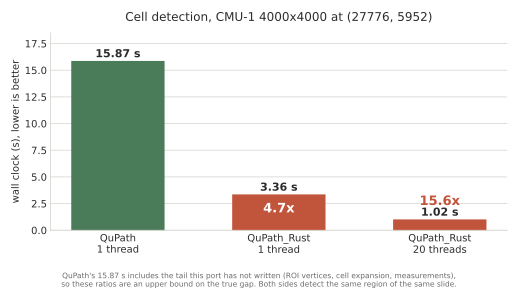

# QuPath_Rust

[](https://github.com/Dante-Berth/QuPath_Rust/actions/workflows/ci.yml)

An accelerated Rust implementation of parts of [QuPath](https://qupath.github.io/):
its watershed cell detection, an Aperio SVS reader, and a slide viewer that
reads and writes QuPath projects and GeoJSON. Behaviour is checked against
output recorded from QuPath itself, not against a reading of its source.

> **Parity is measured, and it is incomplete.** Over ten regions of CMU-1 this
> finds **1.065x** QuPath's object count — 156,979 against 147,351, a range of
> 1.012–1.129 by region — and always over-counts, more so on sparse tissue.
> The nuclei that do correspond agree well: **97.9%** of QuPath's 17,079 nuclei
> match one-to-one, mean Dice **0.921**. So the gap is a population of extra
> objects, not boundaries in different places. It is tracked as D-009 in
> [DIVERGENCES.md](DIVERGENCES.md); read
> [Parity and what to trust](docs/guide/parity.md) before relying on any output.

## Speed

On the region QuPath itself was profiled on — 4000x4000 of `CMU-1.svs`, same
slide, same default parameters:



**4.7x single-threaded, 15.6x on twenty threads.** Read the single-threaded bar
first: QuPath's 15.87 s was measured single-threaded. Read both as an upper
bound: QuPath's time includes the measurements, which are not ported yet.

The main source of the speedup is the data layout, not the language:
detections and their measurements are a struct of arrays, one contiguous column
per feature, where QuPath keeps a string-keyed map per object. Every figure is
backed by a committed recording that states machine, thread count and input —
see [docs/benchmarks/](docs/benchmarks/README.md).

## What is here

| Crate | Does | Checked against QuPath |
| --- | --- | --- |
| `qupath-objects` | Columnar detection/measurement table | recorded fixtures |
| `qupath-watershed` | Marker-controlled flood, labelling, contour tracing, boundary smoothing, cell expansion | flood, labelling and tracing 3 + 13 + 17 cases; contour 9, smoothing 12, expansion 10 |
| `qupath-filters` | Rank filter, ImageJ Gaussian blur, convolution, morphological reconstruction | 42 + 22 + 22 + 24 cases |
| `qupath-slide` | Aperio SVS / tiled TIFF reader, pure Rust | 5 regions and the level table, against OpenSlide |
| `qupath-pipeline` | Tiles a region QuPath's way and runs every detection stage | per stage, and per object by Dice |
| `qupath-viewer` | Pan, zoom, pyramid-level selection; GPU or CPU | no parity claimed |
| `qupath-app` | The viewer with QuPath's panes: detection, projects, GeoJSON export | files opened by QuPath itself |

Every stage `WatershedCellDetection` runs, from colour deconvolution to the area
filter, is ported. What is not: the per-cell measurements, and wiring boundary
smoothing and cell expansion into the pipeline (both are ported and pinned, but
nothing calls them yet). JPEG 2000 slides are refused by name rather than
mis-decoded.

## Quick start

Needs Rust 1.90 or newer; no Java, QuPath or OpenSlide.

```bash
git clone https://github.com/Dante-Berth/QuPath_Rust
cd QuPath_Rust
mkdir -p data
curl -L -o data/CMU-1-Small-Region.svs \
  https://openslide.cs.cmu.edu/download/openslide-testdata/Aperio/CMU-1-Small-Region.svs
cargo run --release -p qupath-app -- data/CMU-1-Small-Region.svs
```

Press `d` to detect cells in the view and `s` to save them as GeoJSON QuPath can
open. On Linux the window needs `libxkbcommon-dev libwayland-dev pkg-config`;
[Installing](docs/guide/installing.md) has the details and the 177 MB slide
every figure here was measured on.

## Documentation

- [docs/guide/](docs/guide/README.md) — the user guide: viewing, detecting,
  projects, exporting, command-line tools.
- [docs/STATUS.md](docs/STATUS.md) — the long form of this page: parity crate
  by crate, the three bugs the fixtures caught, the full speed breakdown, and
  the viewer.
- [DIVERGENCES.md](DIVERGENCES.md) — every place this differs from QuPath, on
  purpose or not.
- [parity/](parity/README.md) — how the fixtures are recorded from QuPath.
- [presentation/](presentation/README.md) — a 20-slide deck on the port, the
  parity gap and the verification method.
- [docs/dev/](docs/dev/) — design records: [MEMO.md](docs/dev/MEMO.md) for
  orientation, [ROADMAP.md](docs/dev/ROADMAP.md) for the plan.
- `cargo doc --workspace --no-deps --open` — the API docs, where each crate
  says what QuPath does, what this does instead, and why.

## Tests

```bash
cargo test --workspace --release
```

594 tests. No slides are committed ([docs/test-data.md](docs/test-data.md)), so
the 18 that need one skip themselves — and a skipped Rust test still prints
`ok`. When a green run is evidence, make skips fail:

```bash
QUPATH_RUST_REQUIRE_DATA=1 cargo test --workspace --release --no-fail-fast
```

CI runs rustfmt, clippy and rustdoc (both with `-D warnings`) and the suite on
the 1.9 MB slide, and its job summary names the tests the 177 MB one would have run.

## Contributing

[CONTRIBUTING.md](CONTRIBUTING.md) has the gate CI runs and the one rule that
matters here: a new parity claim needs a fixture recorded from QuPath **and** a
mutation showing that fixture can fail.

## Licence and citation

GPL-3.0-or-later, matching QuPath. This code was written by reading QuPath's
source to reproduce its behaviour, which makes it a derivative work. To cite
it, see [CITATION.cff](CITATION.cff).
